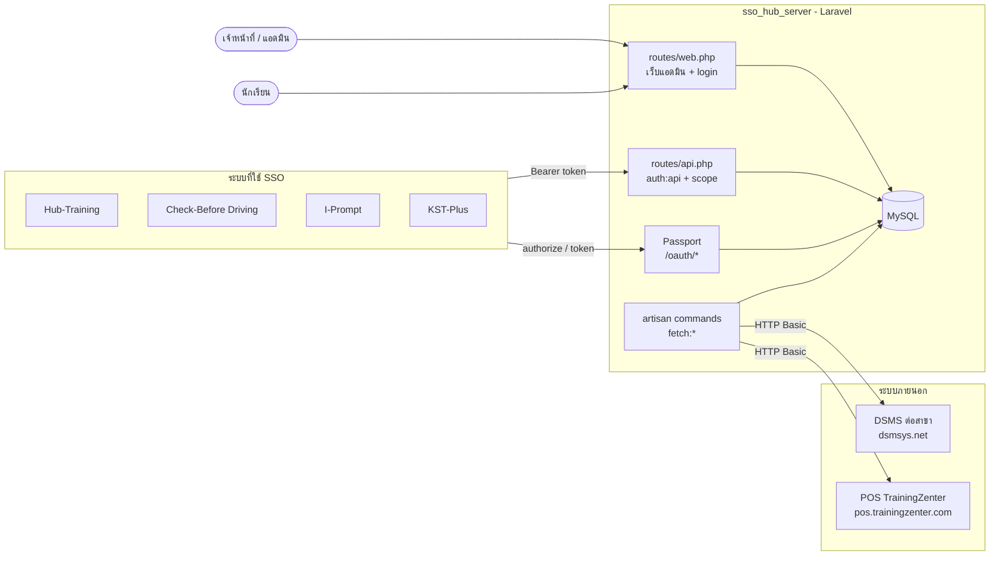

# 01 · สถาปัตยกรรมระบบ

## เทคโนโลยี

| ส่วน | ที่ใช้ |
|---|---|
| Backend | PHP ^8.1, Laravel ^10.10 |
| OAuth2 / SSO | laravel/passport ^11.10 (Sanctum ติดตั้งไว้แต่ไม่ได้ใช้งานจริง) |
| Login หน้าเว็บ | laravel/ui (Auth scaffolding) |
| สิทธิ์ | spatie/laravel-permission ^6.3 |
| UI แบบ reactive | livewire/livewire ^3.4 (ใช้เพียง 1 component และปัจจุบันไม่มี route เข้าถึง) |
| Frontend | Blade + Bootstrap 5 + DataTables, build ด้วย Vite |
| ฐานข้อมูล | MySQL (`sso_hub_server_db`) |
| HTTP client | Guzzle (ผ่าน `Http::` facade) ใช้ในคำสั่งดึงข้อมูล |
| วันที่ภาษาไทย | phattarachai/thaidate |

## ภาพรวม



## โครงสร้างโฟลเดอร์ที่สำคัญ

```
app/
  Console/Commands/     คำสั่ง artisan (ดึงข้อมูล, ปรับข้อมูล) -> 06-data-sync.md
  Http/Controllers/
    HomeController.php      หน้าแรก, จัดการ user/ข้อมูลระบบ/นักเรียน(ตาราง)  (ใหญ่)
    CustomerController.php  CRUD นักเรียน, import, ถังขยะ, คอร์สของนักเรียน
    Auth/                   controller ของ laravel/ui (ใช้ค่าเริ่มต้น)
  Http/Middleware/
    AdminRoleMiddleware     alias 'admin'
    StaffRoleMiddleware     alias 'adminAndStaff' (admin หรือ staff)
  Livewire/UserPermission   จัดการสิทธิ์รายบุคคล (ไม่มี route)
  Models/                   User, Agency, Branch, Course, CourseType, User_has_course, Passport
  Providers/AuthServiceProvider  กำหนดอายุ token และ scope ของ Passport
routes/
  web.php   เว็บแอดมิน     api.php   endpoint ของ SSO (closure ล้วน ไม่มี controller)
resources/views/
  auth/ layouts/ pages/ livewire/ vendor/passport/authorize.blade.php
database/migrations, database/seeders
```

## ข้อสังเกตเชิงสถาปัตยกรรม

- **ไม่มีชั้น service / repository / FormRequest** logic ทั้งหมดอยู่ใน controller และ closure ของ `routes/api.php`
- **ผู้ใช้ทุกประเภทอยู่ตารางเดียว** (`users`): นักเรียน, เจ้าหน้าที่, แอดมิน แยกด้วย Spatie role และคอลัมน์ `role`
- **ใช้รหัสธุรกิจเป็น foreign key** แทน id ของตาราง (เช่น `users.brn` เก็บ `branches.brn_id`) รายละเอียดใน [02-database.md](02-database.md)
- **ตัวเลือกประเภทข้อมูลใน UI ใช้ endpoint เดียวหลายหน้าที่**: `/data/add|update|delete` แยกชนิดข้อมูลด้วย field `addType` / `deltype` (agn, course, brn, perm, role, ctype)
- **ไม่มี scheduler**: `app/Console/Kernel.php` ว่างเปล่า การดึงข้อมูลต้องตั้ง cron / Task Scheduler ภายนอกเอง

## Flow หลัก 3 แบบ

1. **นักเรียนเข้าใช้ระบบปลายทาง** → ดู [03-sso-api.md](03-sso-api.md)
2. **เจ้าหน้าที่จัดการข้อมูลนักเรียน** → ดู [05-admin-ui.md](05-admin-ui.md)
3. **ซิงก์นักเรียนจากระบบภายนอกเข้ามา** → ดู [06-data-sync.md](06-data-sync.md)
