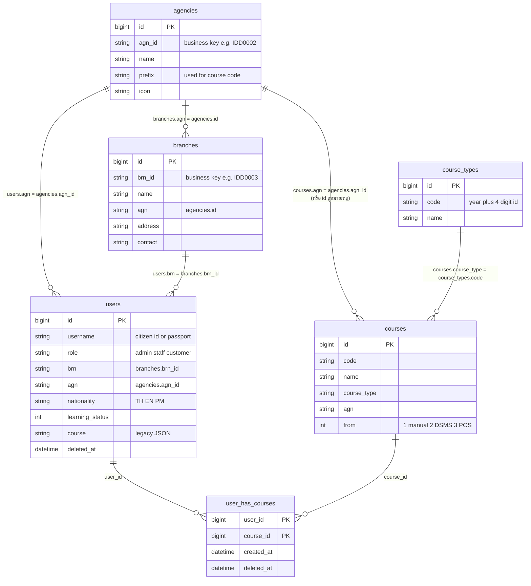

# 02 · ฐานข้อมูล

ฐานข้อมูล MySQL ชื่อเริ่มต้น `sso_hub_server_db` ตารางมาจาก 4 กลุ่ม: ตารางของแอป, Spatie permission, Passport (OAuth) และตารางระบบของ Laravel

## ERD (ตารางของแอป)

## ตารางสำคัญ

### `users`
ตารางเดียวของทุกคน (นักเรียน/เจ้าหน้าที่/แอดมิน) ใช้ SoftDeletes
- `username` เดิมคือคอลัมน์ `email` ถูก rename ใน migration `2024_07_02` และเป็นตัวระบุล็อกอิน (เลขบัตรประชาชน หรือเลขพาสปอร์ต) รหัสผ่านเริ่มต้นของนักเรียนที่ซิงก์เข้ามาคือค่าเดียวกับ `username`
- `role` เป็น string แบบ legacy (`admin`/`staff`/`customer`) ใช้ควบคู่กับ Spatie role (ดู [04-roles-permissions.md](04-roles-permissions.md))
- `prefix`, `name`, `lname` = ชื่อภาษาไทย; `prefix_eng`, `fname_eng`, `lname_eng` = ชื่อภาษาอังกฤษ
- `nationality`: `TH` (คนไทย), `EN` (ต่างชาติ), `PM` (รหัสนักเรียนขึ้นต้น `00` หรือ `PM`) กำหนดอัตโนมัติจากรหัสนักเรียนตอนซิงก์
- `course` คอลัมน์ JSON เดิมก่อนมีตาราง pivot (ยังถูกเขียนโดย import Excel, ดู [08-known-issues.md](08-known-issues.md))
- `staff` เก็บ id ของเจ้าหน้าที่ที่สร้างนักเรียนคนนั้น (ผ่านหน้าเว็บ)

### `agencies` / `branches`
- `agencies`: หน่วยงานแม่ มีรหัสธุรกิจ `agn_id` (เช่น `IDD0002`, `TZ0003`) และ `prefix` (`IDD`, `TZ`) ซึ่ง **ใช้สร้างรหัสคอร์ส**
- `branches`: สาขา มี `brn_id` (เช่น `IDD0003`) และ `agn` ที่เก็บ **id** (ไม่ใช่ `agn_id`) ของ agency

### `courses` / `course_types`
- `courses.code` ถ้าสร้างผ่านหน้าเว็บ = `prefix ของ agency` + `id คอร์ส` + `ปี ค.ศ.` ถ้ามาจากการซิงก์ใช้รหัสจากระบบต้นทาง
- `courses.from` บอกที่มา: `1` สร้างเอง (ค่าเริ่มต้น), `2` DSMS, `3` POS (คอลัมน์ถูกประกาศเป็น boolean แต่เก็บค่า 2, 3 ได้เพราะ MySQL ใช้ tinyint)
- `course_types.code` = ปี + เลข id 4 หลัก (เช่น `20240010`) คำสั่ง `update:coursetype` สร้างประเภทเริ่มต้น: "รถยนต์", "รถจักรยานยนต์", "รถยนต์ต่างชาติ"

### `user_has_courses`
ตารางเชื่อมนักเรียน–คอร์ส primary key คู่ (`user_id`, `course_id`) ใช้ SoftDeletes และ foreign key แบบ cascade
**แถวที่ `created_at` ล่าสุดเป็นตัวกำหนด** ประเภทคอร์สที่ `/api/user` ส่งออก และประเภทยานพาหนะบนหน้าแรก

## ข้อควรระวังเรื่องคีย์ (สำคัญมาก)

| ความสัมพันธ์ | คอลัมน์ฝั่งลูก | อ้างอิงถึง |
|---|---|---|
| user → branch | `users.brn` | `branches.brn_id` (**รหัสธุรกิจ**) |
| user → agency | `users.agn` | `agencies.agn_id` (**รหัสธุรกิจ**) |
| branch → agency | `branches.agn` | `agencies.id` (**primary key**) |
| course → agency | `courses.agn` | ไม่สม่ำเสมอ: คอร์สจาก DSMS และหน้าเว็บใช้ `agn_id`, คอร์สจาก POS ใช้ `id` |
| course → type | `courses.course_type` | `course_types.code` |

ค่า `brn`/`agn` ใน `users` บางแถวอาจยังเป็น **ชื่อ** (จากการ import Excel รุ่นเก่า) คำสั่ง `update:database-normalize` ใช้แปลงเป็นรหัส

ไม่มี foreign key constraint ในฐานข้อมูลสำหรับความสัมพันธ์ข้างต้น (ยกเว้น `user_has_courses`) ความถูกต้องขึ้นกับโค้ดทั้งหมด

## ตารางของ package

- **Spatie**: `roles`, `permissions`, `model_has_roles`, `model_has_permissions`, `role_has_permissions`
- **Passport**: `oauth_auth_codes`, `oauth_access_tokens`, `oauth_refresh_tokens`, `oauth_clients`, `oauth_personal_access_clients` (`client_uuids = true`)
- **Laravel**: `password_resets` / `password_reset_tokens`, `failed_jobs`, `personal_access_tokens`

## ประวัติ migration (เรียงตามเวลา)

| วันที่ | การเปลี่ยนแปลง |
|---|---|
| 2014–2019 | users, password reset, Passport, failed_jobs, personal_access_tokens (ค่าเริ่มต้นของ Laravel) |
| 2024-02-26 | agencies, branches, ตาราง Spatie |
| 2024-05-03 | เพิ่มคอลัมน์นักเรียนใน users (staff, gender, address, province, dob, phone, course, life_time); สร้าง courses |
| 2024-05-04 / 05-15 | `courses.from`, `agencies.prefix`, `courses.agn` |
| 2024-07-02 | users: เพิ่ม `prefix`, `lname`; **rename `email` → `username`** |
| 2024-07-03 | สร้าง `user_has_courses` |
| 2024-07-04 | สร้าง `course_types`; เพิ่ม `courses.course_type` |
| 2024-07-06 | เพิ่ม `agencies.agn_id`, `branches.brn_id` |
| 2024-07-08 | users: ชื่ออังกฤษ, `learning_status`, `nationality` |

## ข้อมูลเริ่มต้น (Seeder)

`php artisan db:seed` รัน `RoleSeeder` (สร้าง role `admin`, `staff`, `customer`) และ `UserSeeder` (สร้างผู้ใช้ `admin` ถ้ายังไม่มี พร้อมรหัสผ่านเริ่มต้นที่เขียนไว้ในไฟล์ — **ควรเปลี่ยนทันทีหลังติดตั้ง**)
