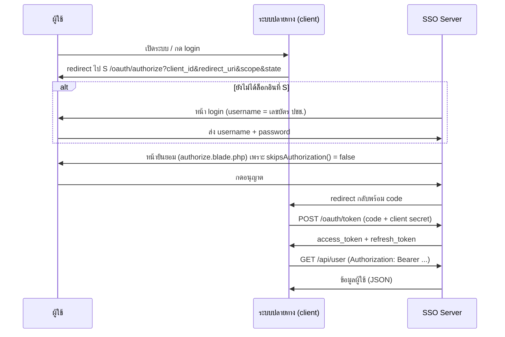

# 03 · SSO และ API

## ขั้นตอน SSO (Authorization Code)

ระบบใช้ Laravel Passport (route `/oauth/*` ถูกลงทะเบียนอัตโนมัติโดย Passport 11) ระบบปลายทางต้องมี OAuth client ที่สร้างด้วย `php artisan passport:client`



- **หน้ายินยอมแสดงทุกครั้ง** เพราะโมเดล client ที่กำหนดเอง `App\Models\Passport` คืนค่า `skipsAuthorization() = false`
- **สลับบัญชี**: `POST /different-account` จะ logout, เก็บ URL authorize ไว้ใน session (`url.intended`) แล้วพาไปหน้า login ใหม่
- **ข้อความผิดพลาด**: หน้าแรก (`/`) แสดง query `login_sso_error` เป็นแถบแจ้งเตือน 3 วินาที (ระบบปลายทางใช้ redirect กลับมาพร้อมข้อความ)

## อายุ token (กำหนดใน `AuthServiceProvider`)

| ชนิด | อายุ |
|---|---|
| Access token | 1 วัน |
| Refresh token | 30 วัน |
| Personal access token | 6 เดือน |

## Scope

| Scope | ความหมาย | ใช้กับ endpoint |
|---|---|---|
| `view-user` | ดูข้อมูลผู้ใช้ | `GET /api/user` |
| `i-prompt` | เข้าใช้ I-Prompt | `GET /api/i-prompt` |
| `kst-plus` | เข้าใช้ KST-Plus | `GET /api/kst-plus` |

## Endpoint ใน `routes/api.php`

ทุก endpoint อยู่ภายใต้ prefix `/api` และเขียนเป็น closure ในไฟล์ route

| Method | Path | การยืนยันตัวตน | ผลลัพธ์ |
|---|---|---|---|
| GET | `/api/user` | `auth:api` + scope `view-user` | ข้อมูลผู้ใช้ (ดูด้านล่าง) |
| GET | `/api/i-prompt` | `auth:api` + scope `i-prompt` | คืนผู้ใช้ถ้ามี permission `i-prompt` (Spatie) ไม่เช่นนั้น `{"message":"Permission denied"}` |
| GET | `/api/kst-plus` | `auth:api` + scope `kst-plus` | คืนโมเดลผู้ใช้ทั้งก้อน (ไม่ตรวจ permission) |
| GET | `/api/logmeout` | `auth:api` | ลบ access/refresh token **ทั้งหมด** ของผู้ใช้นั้น → `{"message":"Revoked"}` |
| GET | `/api/courses` | `auth.basic` | รายการคอร์ส `{code, name, agn}` |
| GET | `/api/courseType` | ไม่ต้องยืนยันตัวตน | รายการประเภทคอร์ส `{code, name}` |

### รูปแบบผลลัพธ์ของ `/api/user`

```json
{
  "name": "นาย สมชาย ใจดี",
  "username": "1234567890123",
  "role": "customer",
  "courses": [{ "course_type": "20240001", "name": "รถยนต์" }],
  "branch":  { "name": "โนนทัน", "brn_id": "IDD0003" },
  "agency":  { "name": "โรงเรียนสอนขับรถ ...", "agn_id": "IDD0002" }
}
```

- `name` ต่อกันเป็น `prefix + name + lname` (ข้ามส่วนที่ว่าง)
- `courses` คือ **ประเภทคอร์สของคอร์สล่าสุดเพียงรายการเดียว** (เรียงตาม `user_has_courses.created_at` ล่าสุด) ไม่ใช่คอร์สทั้งหมด และจะเป็นอาร์เรย์ว่างถ้า `role = staff`
- `branch` / `agency` ค้นจาก `brn_id` / `agn_id` ของผู้ใช้

## การเชื่อมที่ฝั่งหน้าแรก (ลิงก์ออกไปยังบริการ)

หน้าแรก `/` (`home.blade.php`) แสดงการ์ดบริการ 2 รายการหลังล็อกอิน:

- **Hub-Training** → `https://smarthub.trainingzenter.com/sso/login`
- **Check-Before Driving** → `https://checkbefore.trainingzenter.com/sso/{username}/{ชื่อเต็ม}/{course_type}/{send_branch}`

`course_type` (`car` | `motobike` | `trailer`) ได้จากชื่อประเภทคอร์สล่าสุดของนักเรียน (ค้นคำว่า "รถยนต์", "จักรยานยนต์", "บรรทุก" ค่าเริ่มต้น `car`) และ `send_branch` (`idmskk`, `idmsPY`, `idmsMK`, `idmsTK`, `idmsLLK`, `idmsPRO`) ได้จากชื่อสาขาของนักเรียน (ค่าเริ่มต้น `idmskk`)
ข้อควรระวัง: ลิงก์นี้ส่งเลขบัตรประชาชนไปใน path ของ URL ดู [08-known-issues.md](08-known-issues.md)
