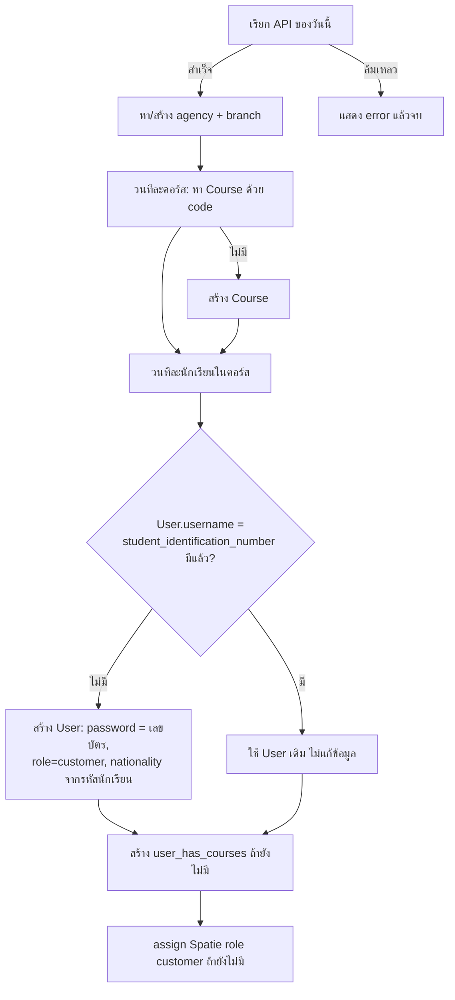

# 06 · การซิงก์ข้อมูลและคำสั่ง artisan

คำสั่งทั้งหมดอยู่ใน `app/Console/Commands/` และถูกโหลดอัตโนมัติ (`Kernel::commands` เรียก `$this->load`) **ไม่มี schedule** ต้องตั้ง cron / Windows Task Scheduler เอง (เช่น รันทุกวัน)

## สรุปคำสั่ง

| คำสั่ง | ใช้ทำอะไร | ชนิด |
|---|---|---|
| `php artisan fetch:apidata {dest}` | ดึงนักเรียน+คอร์ส **ของวันนี้** จาก DSMS ของสาขาที่ระบุ | ซิงก์ประจำ |
| `php artisan fetch:posdata` | ดึงนักเรียน+คอร์ส **ของวันนี้** จาก POS TrainingZenter | ซิงก์ประจำ |
| `php artisan update:database-normalize` | แปลง `users.brn`/`users.agn` จากชื่อ/id เป็น `brn_id`/`agn_id` | ซ่อมข้อมูล (ครั้งเดียว) |
| `php artisan update:coursetype` | สร้างประเภทคอร์สเริ่มต้นและจัดประเภทให้คอร์สเดิม | ซ่อมข้อมูล (ครั้งเดียว) |
| `php artisan update:usercourse` | ย้ายคอร์สจากคอลัมน์ JSON `users.course` ไปตาราง `user_has_courses` | ซ่อมข้อมูล (ครั้งเดียว) |

## `fetch:apidata` (DSMS)

`{dest}` มี 6 ค่า แต่ละค่าเป็นสาขาของโรงเรียน (ค่าอื่น ๆ ตกไปที่สาขาเริ่มต้น = โนนทัน):

| `dest` | สาขา | `brn_id` |
|---|---|---|
| `idmskk` (ค่าเริ่มต้น) | โนนทัน | `IDD0003` |
| `idmsLLK` | ลำลูกกา | `IDD0004` |
| `idmsMK` | มหาสารคาม | `IDD0005` |
| `idmsPRO` | เดอะโปรเฟชชั่นแนล | `IDD0006` |
| `idmsPY` | พยัคฆภูมิพิสัย | `IDD0002` |
| `idmsTK` | แก่งคอย | `IDD0007` |

- URL: `http://www.dsmsys.net/{dest}/tz/?date={วันนี้}` ยืนยันตัวตนด้วย HTTP Basic (header เขียนตายในโค้ด)
- Agency ที่ผูก: prefix `IDD`, `agn_id = IDD0002` (สร้างถ้าไม่มี)
- คอร์สที่สร้าง: `from = 2`, `agn = agencies.agn_id`

## `fetch:posdata` (POS)

- URL: `https://pos.trainingzenter.com/api/student/{วันนี้}` (HTTP Basic เช่นกัน)
- Agency: `TrainingZenter` (prefix `TZ`, `agn_id = TZ0003`), สาขา `TrainingZenter` (`brn_id = TZ0008`)
- คอร์สที่สร้าง: `from = 3`, `agn = agencies.id` (**ต่างจาก DSMS** ที่ใช้ `agn_id`)

## ขั้นตอนประมวลผล (ทั้งสองคำสั่งเหมือนกัน)

### ฟิลด์ที่ใช้จากข้อมูลต้นทาง

ต่อคอร์ส: `course_code`, `course_name_th`, `data[]` · ต่อนักเรียน: `student_identification_number` (→ `username`), `student_code`, `student_prefix_th`, `student_firstname_th`, `student_lastname_th`, `student_prefix_eng`, `student_firstname_eng`, `student_lastname_eng`, `student_learning_status`

### กฎกำหนดสัญชาติ (`nationality`) จาก `student_code`

| เงื่อนไข | ค่า |
|---|---|
| ขึ้นต้น `00` หรือ `PM` | `PM` |
| ความยาวไม่ใช่ 13 (DSMS) / น้อยกว่า 13 (POS) | `EN` |
| อื่น ๆ | `TH` |

### พฤติกรรมที่ควรรู้

- **เป็น idempotent ระดับหนึ่ง**: รันซ้ำวันเดียวกันไม่สร้างซ้ำ (เช็ค `username` และคู่ user-course ก่อน)
- **ไม่อัปเดตนักเรียนเดิม**: ถ้ามี `username` อยู่แล้ว จะไม่แก้ชื่อ สาขา หรือสถานะการเรียน
- **ข้อผิดพลาดรายแถวไม่ทำให้คำสั่งล้ม**: จับ exception ต่อแถวแล้ว `echo` ข้อความ และไปต่อ ดังนั้น exit code เป็น 0 แม้บางแถวพลาด ต้องอ่าน output จึงจะรู้
- นักเรียนที่ถูก soft delete: `User::where(...)->first()` ไม่เห็นแถวที่ถูกลบ → `create` จะชน unique ของ `username` และถูกจับเป็น "Create customer error" (นักเรียนคนนั้นจะไม่ถูกผูกคอร์ส)

## การเพิ่มสาขาใหม่ (ต้องแก้หลายที่)

1. `switch ($apiDest)` ใน `FetchApiDataToDatabase` — เพิ่ม case ชื่อสาขา + `brn_id`
2. `HomeController::index` — เพิ่มเงื่อนไขค้นชื่อสาขา (ภาษาไทย) → ค่า `send_branch` สำหรับ Check-Before Driving
3. ตั้ง cron สำหรับ `fetch:apidata {dest}` ใหม่
4. ตรวจว่าเลือก `brn_id` ไม่ซ้ำกับที่มีอยู่

## คำสั่งซ่อมข้อมูล

- `update:database-normalize` — วนทุก user: ค้น branch/agency ด้วย `name` หรือ `id` เดิม แล้วเขียนทับด้วย `brn_id`/`agn_id`
- `update:coursetype` — สร้างประเภท "รถยนต์", "รถจักรยานยนต์", "รถยนต์ต่างชาติ", "รถจักรยานยนต์ต่างชาติ" (ถ้ายังไม่มี) แล้ววนทุกคอร์สเพื่อตั้ง `course_type` จาก **คำในชื่อคอร์ส** ("รถยนต์"/"รย." → รถยนต์, "จักรยานยนต์"/"จยย." → รถจักรยานยนต์, มีคำว่า "ต่างชาติ" → ประเภทต่างชาติ) คอร์สที่ไม่ตรงกฎใดจะถูกตั้งเป็น `null` **ทับค่าเดิมที่เคยตั้งไว้ด้วย** จึงไม่ควรรันซ้ำหลังจัดประเภทด้วยมือ
- `update:usercourse` — อ่านคอลัมน์ JSON `users.course` แล้วสร้างแถว `user_has_courses` ที่ขาด
