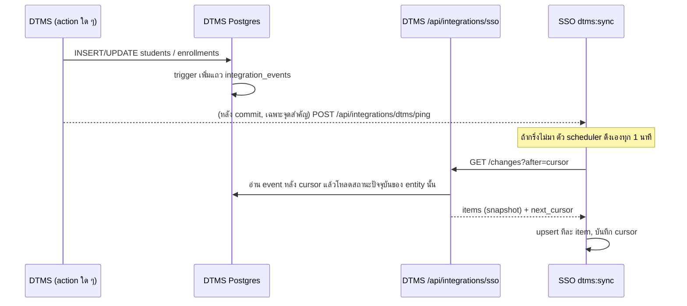

# 09 · การออกแบบการซิงก์ข้อมูลจาก DTMS (ร่าง)

สถานะ: **ร่างเพื่อตกลงร่วมกัน** ยังไม่มีโค้ดทั้งสองฝั่ง สัญญา API อยู่ใน [10-dtms-sync-contract.md](10-dtms-sync-contract.md)
ฝั่งผู้รับคือ **SSO ใหม่แบบหลายโรงเรียน** ([11-new-sso-design.md](11-new-sso-design.md)) ไม่ใช่ระบบเดิมใน repo นี้
แต่ก่อนมี SSO ใหม่ จะให้ SSO เดิมอ่าน feed เดียวกันนี้ก่อน (phase 1) ดู [13-phase1-legacy-dtms-bridge.md](13-phase1-legacy-dtms-bridge.md) ซึ่งตัดบางส่วนของเอกสารนี้ออกเพื่อให้เสร็จเร็ว

## ที่มา

- EM (DSMS, `dsmsys.net`) ปิดแล้ว คำสั่ง `fetch:apidata` จึงไม่มีข้อมูลเข้า นักเรียนใหม่ไม่เข้าระบบ SSO
- DTMS (Next.js 16 + PostgreSQL, multi-tenant `school_id`/`branch_id`) เป็นระบบหลักแทน EM และยังไม่มี API ให้ระบบภายนอก
- POS TrainingZenter (`fetch:posdata`) ยังไม่ตัดสินใจ อยู่นอกขอบเขตเอกสารนี้
- ซิงก์ **ทุกโรงเรียน** ใน DTMS แต่ละโรงเรียนแยกกันในฝั่ง SSO
- พัฒนาทั้งสองฝั่งพร้อมกัน จึงออกแบบแบบ contract-first

## ข้อตกลงหลัก: ใครเป็นเจ้าของข้อมูลอะไร

| ข้อมูล | เจ้าของ | ทิศทาง |
|---|---|---|
| โรงเรียน, สาขา, คอร์ส | DTMS | DTMS → SSO แก้ทับได้ |
| เลขบัตร, ชื่อ (ไทย/อังกฤษ), คำนำหน้า | DTMS | DTMS → SSO แก้ทับได้ |
| การลงทะเบียนเรียน (Enrollment) | DTMS | DTMS → SSO แก้ทับได้ (SSO เก็บแค่ค่าปัจจุบันที่คำนวณได้) |
| รหัสผ่าน, สถานะบัญชี, สิทธิ์ของระบบปลายทางต่อโรงเรียน | SSO | ไม่ซิงก์ (SSO ตั้งรหัสผ่านเริ่มต้นตอนสร้างบัญชีครั้งแรกเท่านั้น) |
| OAuth client, token | SSO | ไม่เกี่ยว |

การซิงก์เป็น **ทางเดียว** (DTMS → SSO) ฝั่ง SSO ไม่ส่งอะไรกลับ และไม่ลบผู้ใช้จากการซิงก์

## ทางเลือกที่พิจารณา

| แบบ | เร็วแค่ไหน | ความง่าย | ข้อมูลหาย/ซ้ำ | สรุป |
|---|---|---|---|---|
| SSO อ่านฐานข้อมูล DTMS ตรง | ทันที | ง่ายตอนแรก | — | ❌ ผูก schema แน่น, ละเมิดกติกา tenant ของ DTMS |
| DTMS ยิง webhook พร้อมข้อมูลเต็มทุกครั้งที่เปลี่ยน | วินาที | ปานกลาง | หายได้ถ้ายิงไม่ถึง, ลำดับสลับได้ | ❌ ต้องทำ retry/ordering เอง |
| SSO ดึง change feed เป็นรอบ | ≤ 1 นาที | ง่าย | ไม่หาย, ซ้ำได้แต่ไม่เป็นไร | ✅ เป็นแกนหลัก |
| **Change feed + webhook "กริ่ง" (ไม่มีข้อมูล)** | วินาที | ง่าย (ใช้โค้ดทางเดียว) | ไม่หาย | ✅ **แนะนำ** |

## แนวทางที่เลือก: feed ของ "สถานะปัจจุบัน" + กริ่งเรียก

หลักคิด 4 ข้อ:

1. **ส่งสถานะ ไม่ส่งเหตุการณ์** feed คืน snapshot ล่าสุดของนักเรียน (พร้อมการลงทะเบียนทั้งหมด) ไม่ใช่ "ลงทะเบียนแล้ว" / "ยกเลิกแล้ว" ฝั่ง SSO จึงไม่ต้องสนใจลำดับ และรับซ้ำกี่รอบก็ได้ผลเท่าเดิม
2. **กริ่งไม่มีข้อมูล** webhook มีแค่ "มีของใหม่" SSO ไปดึง feed เอง ไม่ต้องเชื่อ payload และถ้ากริ่งหาย รอบ 1 นาทีก็ตามทัน
3. **จับการเปลี่ยนแปลงที่ฐานข้อมูล** ใช้ Postgres trigger บน `students`, `enrollments`, `courses`, `branches` เขียนลงตาราง `integration_events` เพื่อจับทุกเส้นทางที่แก้ข้อมูล (POS, ยกเลิก, อนุมัติรอบ, เปลี่ยนตัวผู้เรียน, import) รวมถึง action ที่จะเพิ่มในอนาคต
4. **backfill ใช้ทางเดียวกัน** ตอนเปิดใช้ ให้ DTMS ใส่ event หนึ่งแถวต่อนักเรียน/คอร์ส/สาขาที่มีอยู่ (`INSERT ... SELECT`) SSO เริ่ม cursor จาก 0 ก็ได้ข้อมูลช่วงที่ EM ปิดไปแล้วครบ คำสั่งเดียวกันใช้ซ่อมข้อมูลภายหลังได้ด้วย

## งานฝั่ง DTMS

| งาน | รายละเอียด |
|---|---|
| ตาราง `integration_events` | `id bigserial`, `school_id`, `entity_type` (`school`/`branch`/`course`/`student`), `entity_id`, `created_at` |
| Trigger | AFTER INSERT/UPDATE บน `schools`, `branches`, `courses`, `students`, `enrollments` → เพิ่ม event (`enrollments` ใส่ `entity_type='student'`, `entity_id=student_id`) เป็น SQL migration ใน `db/migrations/` — ยังไม่มี trigger ใน DTMS มาก่อน จึงเป็นธรรมเนียมใหม่ที่ควรบันทึกเป็น ADR |
| Feed endpoint | `GET /api/integrations/sso/changes` ยืนยันด้วย token ของเครื่อง (ไม่ใช่ session) token นี้เป็นระดับแพลตฟอร์ม (เห็นทุกโรงเรียน เหมือนสิทธิ์ super_admin แบบอ่านอย่างเดียว) ขอบเขตมาจาก config ที่ผูกกับ token ห้ามรับ `school_id` จาก query |
| Snapshot builder | ฟังก์ชันใน `lib/integrations/sso/` สร้าง snapshot จาก id; แยก logic แบบ pure ให้ทดสอบด้วย `tsx --test` ได้เหมือน `lib/*-rules.ts` |
| กริ่ง | `after(() => pingSso())` (มีใช้ `after` ใน DTMS อยู่แล้ว) ในจุดที่นักเรียนอาจต้องใช้ SSO ทันที: ลงทะเบียนที่ POS, แปลงบิลล่วงหน้า, เปลี่ยนตัวผู้เรียน, แก้ข้อมูลนักเรียน timeout สั้น ล้มเหลวก็ปล่อย |
| Backfill / re-emit | สคริปต์หรือ migration ใส่ event ของทุกแถวที่มีอยู่ใน school ที่อยู่ในขอบเขต |
| ล้าง event เก่า | cron รายวันลบ event ที่เก่ากว่า N วัน (เหมือน `api/cron/audit-cleanup`) |

## งานฝั่ง SSO ใหม่

ตารางที่เกี่ยวข้อง (`schools`, `branches`, `accounts`, `course_type_map`, `dtms_sync_state`, `dtms_sync_failures`) อธิบายไว้ใน [11-new-sso-design.md](11-new-sso-design.md)
feed นี้ส่งเฉพาะนักเรียน บัญชีเจ้าหน้าที่/ครูฝึกไม่ซิงก์ล่วงหน้า แต่สร้างตอน login ผ่าน endpoint ตรวจรหัสผ่านของ DTMS ([10](10-dtms-sync-contract.md))

| งาน | รายละเอียด |
|---|---|
| โมดูล | `app/Integrations/Dtms/`: `DtmsClient` (HTTP), `SnapshotApplier` (แปลง snapshot → ฐานข้อมูล), `SyncRunner` (วนตาม cursor + lock) |
| คำสั่ง | `php artisan dtms:sync` (ดึงจนหมด) และ `--dry-run` (รายงานว่าจะสร้าง/อัปเดต/ล้มเหลวกี่รายการ โดยไม่เขียน) |
| Scheduler | `dtms:sync` ทุก 1 นาทีพร้อม `withoutOverlapping()` แล้วตั้ง cron บนเซิร์ฟเวอร์ `* * * * * php artisan schedule:run` |
| รับกริ่ง | `POST /api/integrations/dtms/ping` ตรวจ secret แล้วตอบ 202 ทันที สั่ง sync หลังตอบ (`dispatch()->afterResponse()`) ใช้ `Cache::lock` กันรันซ้อน |
| เทสต์ | เทสต์ `SnapshotApplier` ด้วย fixture JSON จากเอกสารสัญญา บนฐานข้อมูลทดสอบแยก |

### กฎการรับ snapshot (ฝั่ง SSO)

1. **school / branch / course**: upsert ด้วย id ของ DTMS (`dtms_school_id`, `dtms_branch_id`) `legacy_code` และ `checkbefore_code` ตั้งด้วยมือในหน้าแอดมิน การซิงก์ไม่แตะสองคอลัมน์นี้
2. **student** → หาบัญชีจาก `(school_id, dtms_student_id)`; ถ้าไม่มี สร้างใหม่ `id_number` จาก snapshot, รหัสผ่านเริ่มต้นตามกติกา, `status = active`
3. เขียนทับชื่อ (ไทย/อังกฤษ) ทุกครั้ง; **ไม่แตะ** รหัสผ่าน, `must_change_password` และการระงับบัญชีที่แอดมินตั้งเอง (เก็บแยกเป็น `admin_disabled` ไม่ปนกับ `status` ที่คำนวณจาก DTMS)
4. คำนวณค่าปัจจุบันจากการลงทะเบียนสถานะ `active` หรือ `pending_cancellation` ล่าสุด (ตาม `enrolled_at`) ถ้าไม่มี ค่าปัจจุบันเป็น `null`: `current_branch_id`, `current_course_type_code` (ผ่าน `course_type_map` ด้วย vehicle type + ตัวเลือกคอร์ส), `current_vehicle_type`
5. คำนวณ `status` ของบัญชี: มีการลงทะเบียน `active` หรือ `pending_cancellation` อย่างน้อยหนึ่งรายการ → `active` ไม่เช่นนั้น → `inactive` (บัญชียังอยู่) ถ้าเปลี่ยนจาก `active` เป็น `inactive` ให้ **เพิกถอน token ทั้งหมดของบัญชีนั้น** ทันที (การลงทะเบียน Online Course เป็น `completed` ตั้งแต่ซื้อ จึงไม่ให้สิทธิ์โดยไม่ต้องมีกติกาพิเศษ)
6. แมปไม่เจอ (เช่น vehicle type ที่ไม่มีใน `course_type_map`) หรือ `id_number` ใหม่ชนกับบัญชีอื่นในโรงเรียนเดียวกัน → บันทึก `dtms_sync_failures` แล้วไปต่อ ไม่หยุดทั้งรอบ
7. snapshot ของโรงเรียนที่ SSO ยังไม่รู้จัก → สร้าง school ก่อน (ปกติ event ของ school มาก่อนอยู่แล้ว)

เพราะบัญชีแยกตามโรงเรียนตั้งแต่ต้น จึงไม่ต้องมีตาราง link ที่ร่างแรกเสนอไว้สำหรับระบบเดิม และไม่มีกรณีบัญชีถูก soft delete ที่ต้องกู้คืน

## ลำดับการทำ (พัฒนาคู่ขนาน)

ลำดับรวมของทั้งโครงการอยู่ใน [11-new-sso-design.md](11-new-sso-design.md) ส่วนของการซิงก์คือ:

| ขั้น | DTMS | SSO ใหม่ | เสร็จเมื่อ |
|---|---|---|---|
| 1 | ตกลงสัญญา [10](10-dtms-sync-contract.md) + fixture | ← เดียวกัน | ทั้งสองฝั่งยอมรับ fixture ชุดเดียวกัน |
| 2 | ตาราง event + trigger + feed + token | ตาราง + applier + เทสต์จาก fixture | เทสต์ผ่านแยกกันทั้งสองฝั่ง |
| 3 | backfill บน staging | `dtms:sync --dry-run` กับ staging | รายงาน dry-run ตรวจแล้ว |
| 4 | กริ่งใน action หลัก | endpoint รับกริ่ง + scheduler | ลงทะเบียนที่ POS แล้ว login SSO ได้ภายในไม่กี่วินาที |
| 5 | backfill บน prod | sync จริง, เฝ้า `dtms_sync_failures` | ไม่มี failure ค้าง |

## เฝ้าระวัง

- หน้าแอดมิน SSO แสดง cursor, เวลา sync สำเร็จล่าสุด และรายการ failure
- ถ้าไม่สำเร็จเกิน 10 นาที ให้แจ้งเตือน (เริ่มจาก log + ตรวจด้วยมือก็พอ เพราะระบบใช้ไม่บ่อย)

## เรื่องที่ต้องตัดสินใจก่อนเริ่มขั้น 2

1. **รหัสเดิมของ IDDrives** ใส่ `legacy_code` ของสาขา (`IDD0003` …) และหน่วยงาน (`IDD0002`) ให้ตรงกับสาขาใน DTMS และใส่ `checkbefore_code` (`idmskk` …) ที่เดิมเดาจากชื่อสาขาภาษาไทย ต้องให้คนที่รู้ข้อมูลจริงกรอก
2. **ตารางแมปประเภทคอร์ส** ระบบปลายทางได้รับ `course_types.code` ของระบบเดิม (เช่น `20240001`) จึงต้องคงรหัสเดิม DTMS แยกตาม Vehicle Type (`CAR`, `MC`, บรรทุก) แต่ "ต่างชาติ" ใน DTMS เป็น **Course Option** ไม่ใช่ Vehicle Type ต้องแมปจาก (vehicle type + ตัวเลือกคอร์ส) และต้องตรวจรหัสจริงในฐานข้อมูล prod ของระบบเดิม (ผมไม่ได้เห็น) โรงเรียนอื่นใช้รหัสชุดเดียวกันหรือไม่ก็ต้องตัดสินด้วย
3. **เลขบัตรถูกแก้ใน DTMS** ให้ SSO เปลี่ยน `id_number` ของบัญชีตามหรือไม่ (กระทบการ login ของนักเรียน แต่ไม่กระทบระบบปลายทางถ้าจับคู่ด้วย `sub`)
4. **สัญชาติ** DTMS ไม่มีฟิลด์นี้ และ `/api/user` ไม่ได้ส่งออก จะต้องมีก็ต่อเมื่อ KST-Plus อ่านจาก `/api/kst-plus` (ระบบเดิมคืนโมเดลผู้ใช้ทั้งก้อน) ถ้าไม่ใช้ ให้ตัดทิ้ง
5. **ข้อมูลส่วนบุคคลที่ SSO ต้องใช้จริง** (PDPA) ร่างสัญญาส่งเท่าที่ endpoint ข้อมูลผู้ใช้ใช้ ไม่ส่งที่อยู่ รูป หรือข้อมูลการเงิน ถ้า KST-Plus ต้องการเพิ่ม ให้เพิ่มเป็นรายฟิลด์
6. **ชื่ออังกฤษ** DTMS เก็บ `fullname_en` ช่องเดียว SSO ใหม่เก็บแบบเดียวกัน ไม่ตัดคำแยกชื่อ-นามสกุล
