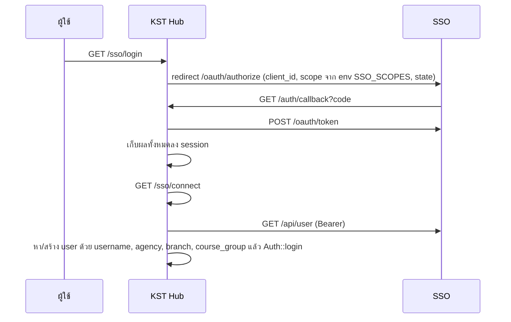

# 12 · บันทึกจากการอ่านโค้ด SSO ของ KST Hub

อ่านจาก repo `kst_hub` (commit `e747cef`) **อ่านอย่างเดียว ไม่ได้แก้ไขไฟล์ใน repo นั้น** ไฟล์หลักคือ `app/Http/Controllers/SSOController.php` และเกี่ยวข้องกับ `routes/web.php`, `app/Models/User.php`, `config/auth.php`
KST Hub คือระบบที่เรียกว่า KST-Plus ในเอกสารก่อนหน้า

## KST Hub ใช้ SSO อย่างไรตอนนี้

- ใช้ **`/api/user`** ไม่ได้เรียก `/api/kst-plus` (ค้นทั้ง repo ไม่พบการเรียก `/api/kst-plus`)
- ฟิลด์ที่อ่านจาก `/api/user`: `username`, `name`, `role`, `agency.agn_id`, `agency.name`, `branch.brn_id`, `branch.name`, `courses[0].course_type`, `courses[0].name` ไม่ได้อ่านสัญชาติหรือข้อมูลส่วนตัวอื่น
- ถ้า `courses` ว่าง จะปฏิเสธการเข้าใช้ (`SSOController.php:141-143`)
- ตอน logout เรียก `/api/logmeout` ของ SSO (`User.php` `logoutFromSSOServer`)
- ค่า client id, secret, callback, scope, host อ่านจาก env ทั้งหมด ไม่มีค่าเริ่มต้นเขียนตายใน `config/auth.php` (ดีกว่าของ SSO เดิม)

ผลต่อ SSO ใหม่: ส่งแค่ฟิลด์ข้างต้นก็พอ ไม่ต้องทำ `/api/kst-plus` และไม่ต้องส่งสัญชาติ แต่ควรคงชื่อ scope `kst-plus` ไว้ เผื่อ `SSO_SCOPES` ของ KST Hub ขอ scope นี้อยู่ (ต้องดูค่าใน `.env` ของ prod ซึ่งผมไม่ได้เปิด)

## สิ่งที่ควรแก้ใน KST Hub

เรียงตามความเร่งด่วน **ทุกข้อเป็นข้อเสนอ ยังไม่ได้แก้**

### ความปลอดภัย (ควรแก้แม้ยังไม่ย้าย SSO)

| # | ปัญหา | ที่อยู่ | ข้อเสนอ |
|---|---|---|---|
| K1 | **login ด้วยรหัสผ่านใน query string** `/public-login?username=…&password=…` และนักเรียนที่สร้างจาก SSO มีรหัสผ่าน = เลขบัตร (ข้อ K2) → ใครรู้เลขบัตรก็เข้าบัญชีนักเรียนได้โดยไม่ผ่าน SSO และรหัสผ่านติดอยู่ใน log ของ web server | `routes/web.php:40-55` | ปิด route นี้ ถ้ายังมีระบบใดใช้ ให้เปลี่ยนเป็น POST และห้ามใช้กับบัญชีนักเรียน |
| K2 | ผู้ใช้ที่สร้างจาก SSO ได้รหัสผ่าน local = เลขบัตร (`password` cast เป็น `hashed` จึงถูก hash แต่เดาได้) และหน้า `/` มีฟอร์ม login ของ KST Hub เอง | `SSOController.php:76` | ตั้งรหัสผ่านสุ่มที่ไม่มีใครรู้ (`Str::random(64)`) ให้บัญชีจาก SSO นักเรียนต้องเข้าผ่าน SSO อย่างเดียว |
| K3 | **ไม่ตรวจ `state`** (บรรทัดถูกคอมเมนต์) เปิดช่องให้ผู้ไม่หวังดีทำให้เหยื่อ login เป็นบัญชีของผู้ไม่หวังดีได้ (login CSRF) | `SSOController.php:37` | เปิดการตรวจกลับมา และเทียบด้วย `hash_equals` |
| K4 | **เจ้าหน้าที่ทุกคน login เป็นบัญชีเดียวกัน** `iddriverstaff` ไม่รู้ว่าใครทำอะไร และเมื่อโรงเรียนอื่นเข้ามา เจ้าหน้าที่โรงเรียนอื่นจะได้บัญชีเจ้าหน้าที่ของ IDDrives | `SSOController.php:68-69` | สร้างบัญชีรายคนจาก `sub` พร้อมโรงเรียนและ role ที่ SSO ใหม่ส่งให้ |
| K5 | ส่งข้อความ exception ดิบกลับไปแสดงที่ SSO (`?login_sso_error=` + `$th->getMessage()`) อาจเปิดเผยรายละเอียดภายใน | `SSOController.php:163` | แสดงข้อความทั่วไป แล้วบันทึกรายละเอียดลง log ของ KST Hub |

### ความถูกต้อง (ต้องแก้ก่อนเปิดให้โรงเรียนอื่น)

| # | ปัญหา | ที่อยู่ | ข้อเสนอ |
|---|---|---|---|
| K6 | จับคู่ผู้ใช้ด้วย `username` (เลขบัตร) คนเดียวกันที่อยู่สองโรงเรียนจะรวมเป็นผู้ใช้เดียว | `SSOController.php:71` | เพิ่มคอลัมน์ `sso_sub` + โรงเรียน ใน `users` จับคู่ด้วย `sub`; ครั้งแรกหาด้วย `username` เดิมแล้วบันทึก `sub` |
| K7 | หา agency และ branch ด้วย **ชื่อ** (`orWhere('name', …)`) แล้ว `update` ทับรหัส ชื่อสาขาซ้ำข้ามโรงเรียนได้ปกติ (และแผน self-serve signup ของ DTMS ตั้งชื่อสาขาแรกของทุกโรงเรียนว่า "สำนักงานใหญ่") → สาขาของหลายโรงเรียนจะถูกรวมเป็นแถวเดียว | `SSOController.php:107-127` | หาด้วยรหัสอย่างเดียว และให้สาขาผูกกับโรงเรียนเสมอ (school id + branch id จาก SSO ใหม่) |
| K8 | `course_group` หาด้วย `code` อย่างเดียว ไม่ดูโรงเรียน กลุ่มที่สร้างครั้งแรกผูกกับ agency ของผู้ใช้คนแรก → นักเรียนต่างโรงเรียนที่มีประเภทคอร์สเดียวกันจะอยู่กลุ่มเดียวกัน | `SSOController.php:132-140` | หาด้วย (agency, code) หรือตัดสินใจว่ากลุ่มเป็นของกลาง แล้วแยกข้อมูลด้วยวิธีอื่น |
| K9 | ไม่ตรวจผลการแลก code เป็น token เก็บผลลงทั้ง session แม้ล้มเหลว แล้วไปพังตอนเรียก `/api/user` ด้วย error ที่ไม่ตรงสาเหตุ | `SSOController.php:39-50` | ตรวจ `$response->successful()` ก่อน และเก็บเฉพาะ `access_token`/`refresh_token` |
| K10 | ผู้ใช้เดิมไม่ถูกอัปเดตชื่อเมื่อชื่อเปลี่ยนในต้นทาง (ตั้งชื่อเฉพาะตอนสร้าง) | `SSOController.php:72-106` | อัปเดตชื่อทุกครั้งที่ login |
| K11 | ลบผู้ใช้ออกจาก group อื่นทั้งหมด เหลือแค่กลุ่มของคอร์สล่าสุด | `SSOController.php:155` | ต้องตรวจว่าการลบนี้ทำให้ประวัติเรียนหรือคะแนนของกลุ่มเก่าหายไหม (ผมไม่ได้ตรวจตารางที่เกี่ยวข้อง) |

### เรื่องที่ต้องทำเมื่อย้ายไป SSO ใหม่

- อ่าน `access_level` จาก `/api/user` แล้วบังคับ `read_only` สำหรับโรงเรียนนอก IDDrives (ตามที่ตกลงว่าระบบปลายทางจัดการเอง)
- รับมือกรณี SSO ปฏิเสธเพราะสิทธิ์หมด (เรียนจบ/ยกเลิก) ให้แสดงข้อความที่เข้าใจได้
- `/api/logmeout` ของ SSO เดิมลบ token **ทุกระบบ** ของผู้ใช้ การ logout จาก KST Hub จึงทำให้หลุดจาก SmartHub ด้วย SSO ใหม่ควรมีวิธี logout ที่เจาะจงเฉพาะ client (ดู [11](11-new-sso-design.md)) แล้ว KST Hub เปลี่ยนไปใช้วิธีนั้น
- import ที่ไม่ได้ใช้ (`department`, `Hash`, `InvalidArgumentException`) ลบได้ตอนแก้ไฟล์นี้
