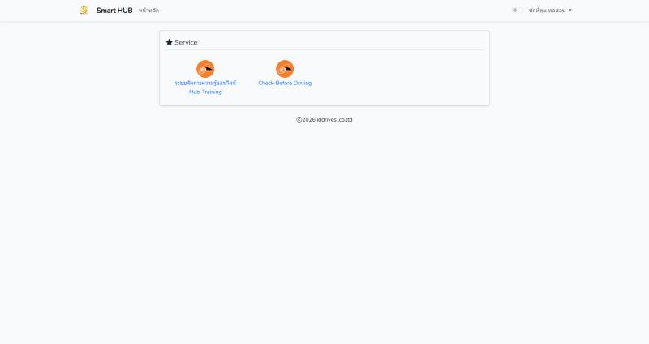
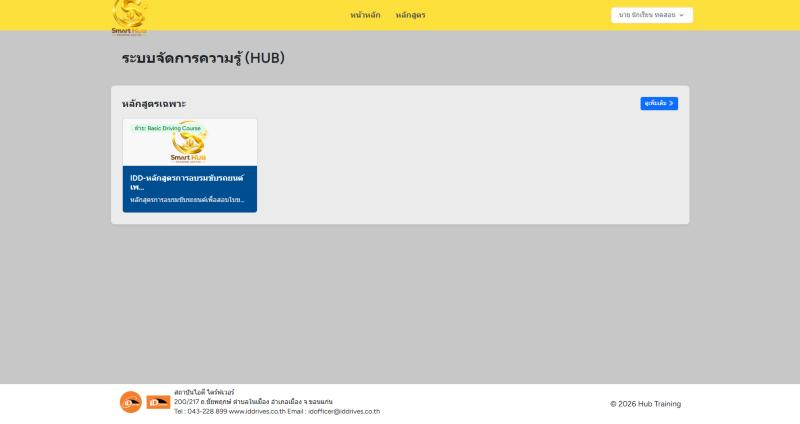
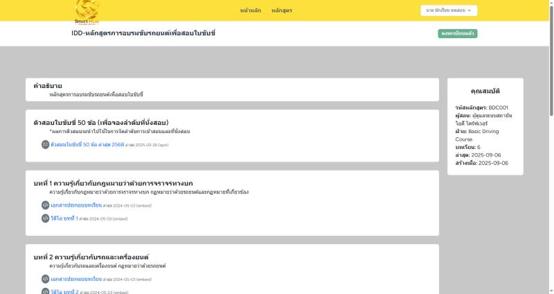
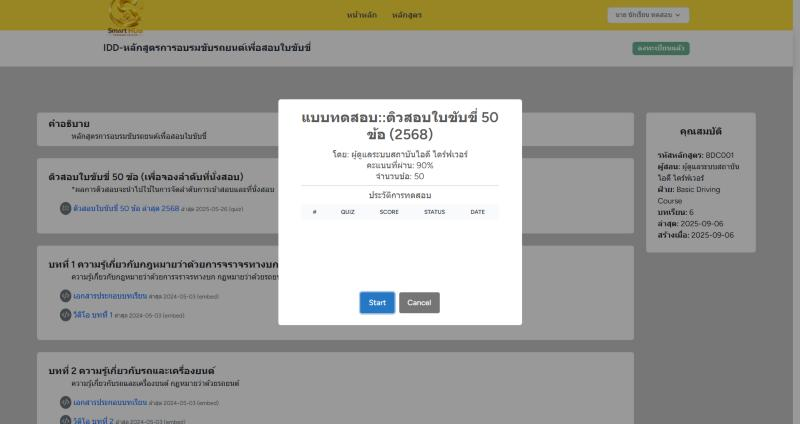
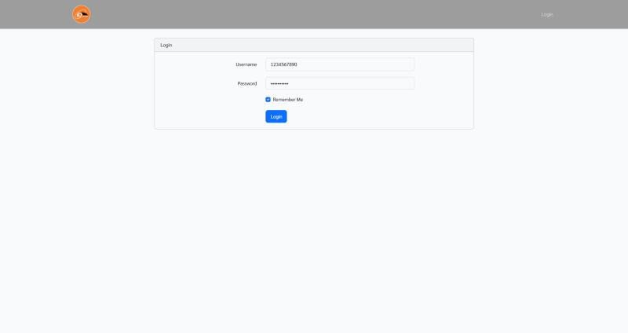
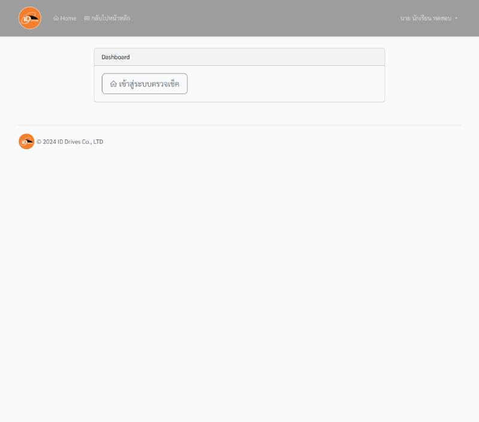
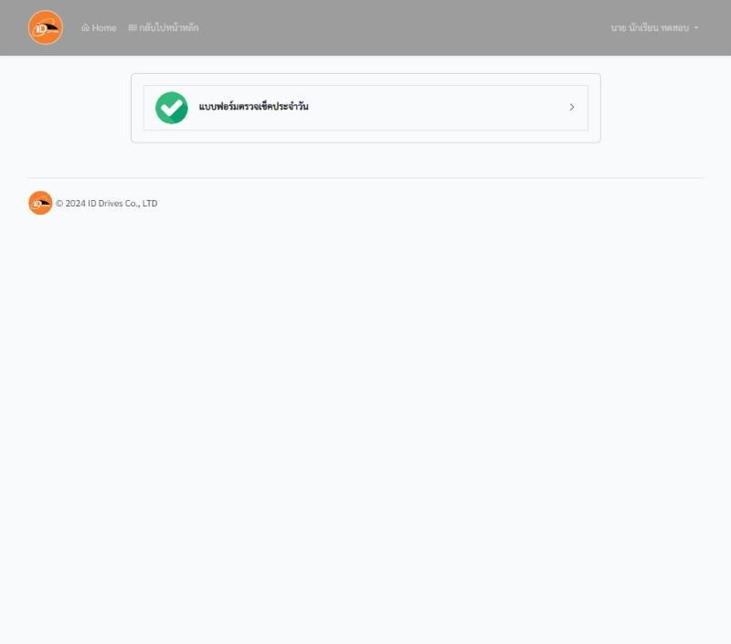
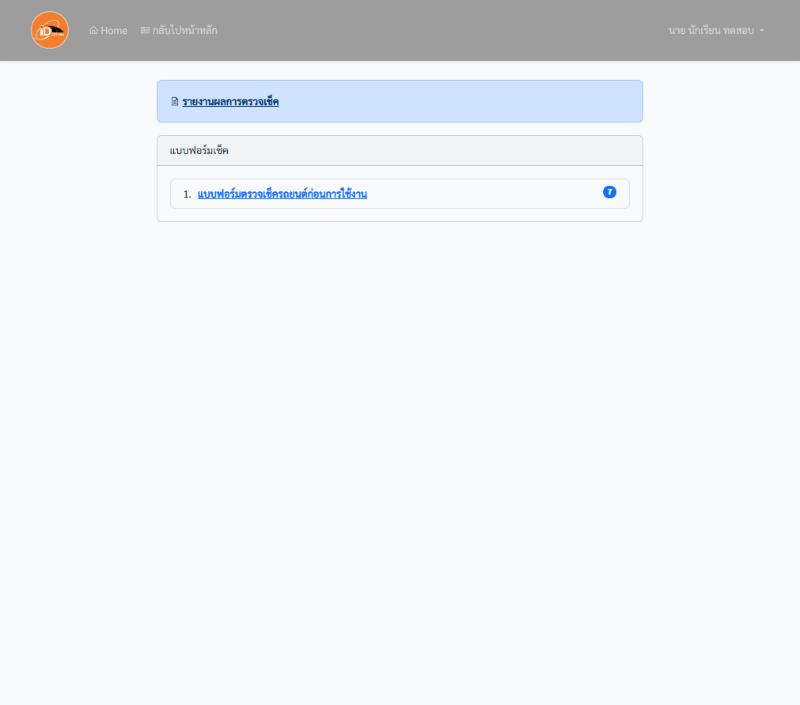
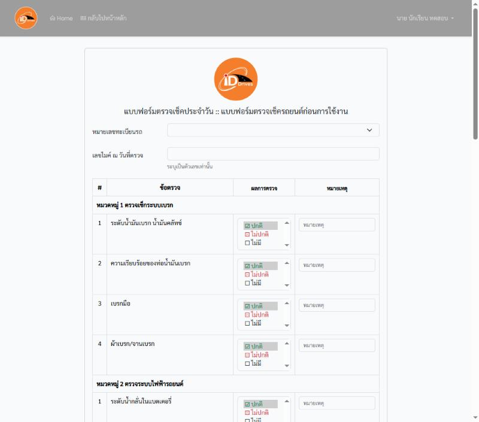

# คู่มือเข้าใช้งานระบบสำหรับนักเรียน (แบบสั้น)

ระบบมี 3 ส่วน: **หน้าเข้าสู่ระบบ (SSO)** → เลือกบริการ → **SmartHub** (เรียน/ทำแบบทดสอบ) หรือ **Check-Before** (ตรวจเช็ครถ)
ล็อกอินครั้งเดียวที่ SSO แล้วเข้าได้ทั้งสองระบบ

---

## 1. เข้าสู่ระบบ

1. เปิดเบราว์เซอร์ไปที่ **https://sso.trainingzenter.com/login**
2. กรอก **เลขบัตรประชาชน** (หรือเลขพาสปอร์ตสำหรับชาวต่างชาติ) ในช่องแรก
3. กรอก **เลขเดิมซ้ำ** ในช่อง "ยืนยันเลขบัตรประชาชน"
4. กด **เข้าสู่ระบบ**

เมื่อเข้าสำเร็จจะเห็นหน้า **Service** มี 2 บริการให้เลือก:

| บริการ | ใช้ทำอะไร |
|---|---|
| ระบบจัดการความรู้ออนไลน์ **Hub-Training** (SmartHub) | เรียนบทเรียน ดูวิดีโอ และทำแบบทดสอบ |
| **Check-Before Driving** | ตรวจเช็คสภาพรถก่อนใช้งาน |

---

## 2. SmartHub: เรียนและทำแบบทดสอบ

1. ที่หน้า Service กด **ระบบจัดการความรู้ออนไลน์ Hub-Training**
2. หากมีหน้ายืนยัน "ลงทะเบียนด้วยชื่อผู้ใช้" ให้กดปุ่มที่มีชื่อของคุณ (ครั้งแรกเท่านั้น)

   

3. เลือกหลักสูตรของคุณที่หน้า "ระบบจัดการความรู้ (HUB)" แล้วกด **ดูหลักสูตร**

   

4. กดปุ่ม **ลงทะเบียน** ที่มุมขวาบน (ครั้งแรกเท่านั้น) ระบบจะเปิดรายการบทเรียนให้

   

   - **บทที่ 1, 2, ...**: กดเปิดเอกสารประกอบการเรียนและวิดีโอของแต่ละบท
   - **ตัวสอบใบขับขี่ 50 ข้อ**: แบบทดสอบฝึกซ้อมก่อนสอบจริง

5. การทำแบบทดสอบ: กดชื่อแบบทดสอบ จะมีหน้าต่างบอกเกณฑ์ผ่าน (90%) และจำนวนข้อ (50) กด **Start** เพื่อเริ่ม ถ้ายังไม่พร้อมกด **Cancel**

   

   ผลสอบแต่ละครั้งจะแสดงในตาราง "ประวัติการทดสอบ" ของหน้าต่างนี้

---

## 3. Check-Before: ตรวจเช็ครถ

1. ที่หน้า Service กด **Check-Before Driving** (จะเปิดในแท็บใหม่)
2. หน้า Login จะมีชื่อผู้ใช้และรหัสผ่านถูกกรอกให้อยู่แล้ว กด **Login**

   

3. กด **เข้าสู่ระบบตรวจเช็ค**

   

4. กด **แบบฟอร์มตรวจเช็คประจำวัน**

   

5. กด **แบบฟอร์มตรวจเช็ครถยนต์ก่อนการใช้งาน** ส่วน **รายงานผลการตรวจเช็ค** ใช้ดูประวัติ

   

6. กรอกแบบฟอร์ม
   - เลือก **หมายเลขทะเบียนรถ** ที่จะใช้
   - ใส่ **เลขไมล์** (ตัวเลขเท่านั้น)
   - ตรวจแต่ละข้อตามหมวด (เบรก ไฟฟ้า ฯลฯ) แล้วเลือกผล **ปกติ / ไม่ปกติ / ไม่มี** ถ้าไม่ปกติให้ใส่ **หมายเหตุ**
   - เลื่อนลงล่างสุดแล้วกด **บันทึกข้อมูล**

   

---

## ปัญหาที่พบบ่อย

- **เข้าสู่ระบบไม่ได้**: ตรวจว่ากรอกเลขบัตรประชาชนครบและตรงกันทั้งสองช่อง ถ้ายังไม่ได้ให้แจ้งเจ้าหน้าที่สาขา
- **Check-Before ไม่เปิด**: เบราว์เซอร์อาจบล็อกหน้าต่างป๊อปอัป ให้อนุญาตป๊อปอัปของเว็บไซต์ แล้วกดใหม่
- **อยากออกจากระบบ**: กดชื่อของคุณมุมขวาบน แล้วเลือก **Logout**
