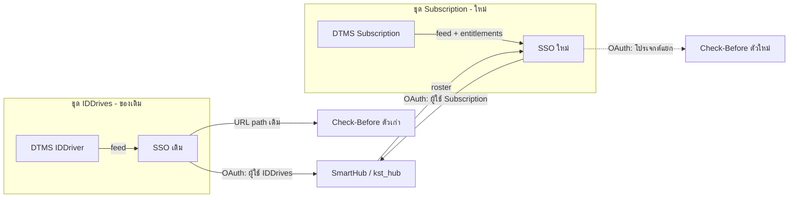

# SSO ใหม่สำหรับ DTMS Subscription (สเปกการออกแบบ)

สถานะ: **ผ่านการตรวจร่วมกับผู้ใช้ทีละส่วนแล้ว พร้อมเขียนแผนการทำ**
วันที่: 2026-11-12
แทนที่: [docs/11-new-sso-design.md](../../11-new-sso-design.md) (ร่างเดิมที่ออกแบบสำหรับ DTMS ทุกชนิดรวมกัน)
เมื่อสร้าง repo ใหม่ ให้ย้ายเอกสารนี้และ docs 09–12 ไปไว้ที่นั่น

## 1. เป้าหมายและขอบเขต

### เป้าหมาย

1. มี SSO ตัวใหม่ **เฉพาะ DTMS Subscription** (หลายโรงเรียน) หน้าตาและ flow คล้ายระบบเดิม
2. ซ่อนบริการตามแพ็กเกจของโรงเรียน: `starter` ไม่เห็น Check-Before, `pro` เห็นทั้งหมด และ **บังคับที่ SSO** ไม่ใช่แค่ซ่อนปุ่ม
3. SmartHub (และ Check-Before ตัวใหม่ในอนาคต) ใช้ได้กับ SSO สองตัว โดย SSO ทั้งสองไม่ต้องรู้จักกัน
4. ข้อมูลของแต่ละโรงเรียนแยกกัน คนเดียวกันที่อยู่สองโรงเรียนต้องเป็นสองบัญชี

### ไม่ทำใน v1

- Check-Before ตัวใหม่ (โปรเจกต์แยก สเปกของตัวเอง) และการแก้ Check-Before ตัวเก่า
- login ของเจ้าหน้าที่/ครูฝึก/แอดมินโรงเรียน (เพิ่มทีหลังด้วย migration)
- ลืมรหัสผ่านทางอีเมล (นักเรียนไม่มีอีเมลใน DTMS)
- `/api/i-prompt`, `/api/kst-plus`, `/api/courses`, `/api/courseType`
- ย้ายข้อมูลหรือ token จาก SSO เดิม (ไม่มีการย้าย SSO เดิมเลย)
- สร้าง/แก้นักเรียน คอร์ส สาขา (เป็นของ DTMS)

## 2. บริบทระบบ

SSO ที่ใช้อยู่ตอนนี้ (repo `sso_hub_server`, branch `main`) รับข้อมูลจาก **DTMS IDDriver** ตาม Phase 1 และใช้งานได้ **ไม่รื้อ** SSO ใหม่เป็นอีกระบบที่ทำงานคู่กัน



- ผู้ใช้เข้า **portal ของ SSO ตัวเอง** ล็อกอินแล้วกดการ์ดบริการ ระบบปลายทางไม่ต้องตัดสินใจว่าจะไป SSO ไหน (ลิงก์ในการ์ดบอกต้นทางอยู่แล้ว)
- SmartHub = repo `D:\WebApp\kst_hub` (ที่ [docs/12](../../12-kst-hub-sso-notes.md) เรียก KST Hub / KST-Plus ชื่อเดียวกัน)

### DTMS ทั้งสองชุด

สอง repo (`D:\WebApp\DTMS\dtms` branch `iddriver`, `D:\WebApp\DTMS\dtms-subscription` branch `master`) มาจากโค้ดหลักเดียวกันแต่พัฒนาฟังก์ชันต่างกัน
- Subscription มี `plans` (`starter`/`pro`), `subscriptions`, `plan_features`, `hasEntitlement()` ([ADR 0018](D:/WebApp/DTMS/dtms-subscription/docs/adr/0018-plan-entitlement-is-a-separate-hasentitlement-layer.md)) และสถานะ `trialing`/`active`/`past_due`/`suspended`/`cancelled`
- **SSO change feed มีเฉพาะฝั่ง IDDriver** ([docs/api/sso-change-feed.md](D:/WebApp/DTMS/dtms/docs/api/sso-change-feed.md)) Subscription ยังไม่มี

## 3. การตัดสินใจที่ตกลงแล้ว

| เรื่อง | ตัดสินใจ |
|---|---|
| สแตก/repo | Laravel + Passport, **repo ใหม่**, สร้างใหม่ ยกมาเฉพาะโค้ด sync และกฎ snapshot จาก Phase 1 |
| การซ่อนบริการ | DTMS ส่ง `entitlements` ของแต่ละโรงเรียน (จาก `plan_features`) SSO ไม่รู้จักชื่อแพ็กเกจ |
| โรงเรียน `suspended` | นักเรียนยังเข้าได้ ปิดเฉพาะ `cancelled` (`entitlements = []`) และ `is_active = false` |
| flow เข้าระบบปลายทาง | login ที่ portal ของ SSO แล้วกดการ์ด ระบบปลายทางเริ่ม OAuth เอง |
| Check-Before | v1 ไม่แตะ ซ่อน/ปิดการ์ดไว้ ทำตัวใหม่ (OAuth, ไม่มี login ของตัวเอง) เป็นโปรเจกต์แยก รับเฉพาะ SSO ใหม่ก่อน |
| SmartHub จำแนกผู้ใช้ | `(ต้นทาง SSO, sub)` |
| โครงสร้างใน SmartHub | โรงเรียน 1 แห่ง = 1 agency = 1 branch ของ SmartHub สาขาจริงแยกด้วยหน้ากรองจากรายชื่อเลขบัตรที่ดึงจาก SSO |
| รายชื่อเลขบัตรรายสาขา | SmartHub ดึงจาก **SSO** (ไม่ดึงตรงจาก DTMS) |
| login นักเรียน | เลขบัตร + รหัสผ่าน (ไม่ใช้เลขบัตรอย่างเดียว) |
| แอดมิน SSO | ตาราง `admins` ของ SSO เอง สร้างด้วย artisan (ไม่ผูก DTMS ใน v1) |

## 4. ตัวตนและฐานข้อมูล

หลักการ: DTMS เป็นเจ้าของข้อมูล SSO เก็บเท่าที่ใช้ login และตอบระบบปลายทาง

ยืนยันจากโค้ด DTMS Subscription: `students` ไม่มีรหัสผ่านและไม่มีสาขาของตัวเอง (สาขาอยู่ที่ `enrollments.branch_id`) และ `id_number` ไม่ซ้ำภายในโรงเรียน แต่ซ้ำข้ามโรงเรียนได้

| ตาราง | คอลัมน์สำคัญ |
|---|---|
| `schools` | `dtms_school_id`, `slug`, `name`, `is_active`, `entitlements` (JSON เช่น `["smarthub","check_before"]`) |
| `branches` | `dtms_branch_id`, `school_id`, `code`, `name`, `is_active` |
| `accounts` | `id` (= `sub`, UUID), `school_id`, `dtms_student_id`, `id_number`, `password`, `password_changed_at`, `must_change_password`, ชื่อไทย/อังกฤษ, `current_branch_id`, `current_vehicle_type`, `status`, `admin_disabled`, `last_login_at` · unique `(school_id, id_number)` และ `(school_id, dtms_student_id)` |
| `client_services` | `client_id` (→ ตาราง client ของ Passport), `name`, `icon`, `launch_url`, `entitlement_key`, `is_launchable`, `skip_consent`, `sort_order` — ทั้งใช้สร้างการ์ดใน portal และกำหนดว่า client ต้องการสิทธิ์อะไร |
| `admins` | แอดมิน SSO แยกจากนักเรียน |
| `dtms_sync_state`, `dtms_sync_failures` | cursor, เวลา sync สำเร็จล่าสุด, รายการที่ล้มเหลว |
| ตาราง Passport | ของ Laravel Passport |

### กติกา

- บัญชี = (โรงเรียน, เลขบัตร) มี `sub` คงที่ตลอดอายุ เป็นตัวระบุหลักให้ระบบปลายทาง
- รหัสผ่านเริ่มต้น = เลขบัตรที่ **trim แล้ว** (กติกาเดียวกับ Phase 1) ผู้ใช้เปลี่ยนเองได้ และเมื่อเปลี่ยนให้ตั้ง `password_changed_at`
- `status` เป็น active เมื่อมี enrollment สถานะ `active` หรือ `pending_cancellation` อย่างน้อยหนึ่งรายการ เรียนจบ (`completed`) หรือยกเลิก (`cancelled`) ทุกรายการ → ไม่ active บัญชียังอยู่ ลงทะเบียนใหม่แล้วกลับมาใช้ด้วยรหัสเดิมได้
- **เข้าใช้ client ได้เมื่อ:** `schools.is_active` และ `status` active และไม่ `admin_disabled` และ `client_services.entitlement_key` ของ client นั้นอยู่ใน `schools.entitlements`
- เก็บแค่ค่าปัจจุบัน ไม่เก็บรายการลงทะเบียนทั้งหมด
- ไม่มีคอลัมน์ `kind` ใน v1 (มีแต่นักเรียน) เพิ่มทีหลังเมื่อเปิดขั้น staff

## 5. Login, portal และการผ่านไประบบปลายทาง

### Login (หน้าเดียว เลขบัตร + รหัสผ่าน)

1. ตรวจรหัสผ่านกับทุกบัญชีที่มีเลขบัตรนั้น
2. ตรง 1 บัญชี → เข้าเลย · ตรงหลายบัญชี → หน้าเลือกโรงเรียน · ไม่ตรงเลย → ข้อความผิดพลาดแบบเดียวเสมอ (ไม่บอกว่าผิดที่เลขบัตรหรือรหัสผ่าน)
3. หลังรหัสผ่านถูก จึงตรวจสิทธิ์และบอกเหตุผลตรงๆ: สิทธิ์การเรียนสิ้นสุดแล้ว / โรงเรียนปิดการใช้งาน / บัญชีถูกระงับ
4. จำกัดจำนวนครั้งที่ลองผิดต่อเลขบัตรและ IP
5. session ผูกกับบัญชีเดียว มีลิงก์สลับโรงเรียน/บัญชี (แบบ `/different-account` ของเดิม)

### Portal (`/` หลัง login)

- การ์ดบริการสร้างจาก `client_services` เฉพาะที่ `entitlement_key` อยู่ใน `entitlements` ของโรงเรียนผู้ใช้ และ `is_launchable` เพิ่มบริการใหม่ = เพิ่มแถว ไม่ต้องแก้โค้ด
- v1: SmartHub เปิดใช้งาน Check-Before มีแถวแต่ `is_launchable = false`
- เมนูผู้ใช้: เปลี่ยนรหัสผ่าน, ออกจากระบบ

### การเข้าระบบปลายทาง

- การ์ดลิงก์ไป `smarthub…/sso/subscription/login` SmartHub เริ่ม OAuth เอง
- `/oauth/authorize`: ไม่มี session → ไป login แล้วกลับมา · โรงเรียนไม่มีสิทธิ์ของ client → ปฏิเสธและกลับ portal พร้อมข้อความ
- หน้ายินยอม: คงแสดงทุกครั้งเหมือนระบบเดิม ผ่านธง `skip_consent` ต่อ client (SmartHub = false) การตั้งค่าของ Check-Before ตัดสินใจตอนทำตัวใหม่

### Logout

`POST /api/logout` เพิกถอนเฉพาะ token ของ client ที่เรียก และคง `GET /api/logmeout` เป็น alias ที่ทำงานแบบเดียวกัน (ต่างจากเดิมที่ลบทุก client)

### แอดมิน SSO

จัดการ client และ `client_services`, ดูโรงเรียนและ `entitlements` ที่ได้จาก feed (อ่านอย่างเดียว), ค้นหาบัญชี/รีเซ็ตรหัสผ่านเป็นเลขบัตร/ระงับบัญชี, ดูสถานะ sync และรายการที่ล้มเหลว สร้างแอดมินด้วย artisan

## 6. API สำหรับระบบปลายทาง

### `GET /api/user` (scope `view-user`)

```json
{
  "sub": "0b9f…uuid",
  "name": "นาย สมชาย ใจดี",
  "username": "1234567890123",
  "role": "customer",
  "agency": { "agn_id": "51f0…school-uuid", "name": "โรงเรียน…" },
  "branch": { "brn_id": "51f0…school-uuid", "name": "โรงเรียน…" },
  "courses": [{ "course_type": "<vehicle type code>", "name": "รถยนต์" }],
  "school": { "id": "51f0…", "slug": "abc-driving", "name": "โรงเรียน…" },
  "school_branch": { "id": "…", "code": "HQ", "name": "สำนักงานใหญ่" },
  "vehicle_type": "car"
}
```

- คงฟิลด์ที่ SmartHub อ่านอยู่ (`username`, `name`, `role`, `agency`, `branch`, `courses[0]`) ([docs/12](../../12-kst-hub-sso-notes.md))
- `agency` และ `branch` ของ SmartHub = โรงเรียน ใช้ UUID ของโรงเรียนทั้งคู่ (ไม่ชนรหัส `IDD000x` เดิม) สาขาจริงอยู่ใน `school_branch`
- `role` เป็น `customer` เสมอใน v1 · `courses` มีรายการเดียว = ประเภทรถปัจจุบัน · ไม่มี `access_level`
- ตรวจสิทธิ์ตามข้อ 4 ทุกครั้ง ไม่ผ่าน → 403

### Roster สำหรับหน้ากรองสาขาของ SmartHub

- `GET /api/schools/{school}/branches` — รายการสาขา
- `GET /api/schools/{school}/branches/{branch}/roster` — เลขบัตรของบัญชีที่ `current_branch` = สาขานั้น พร้อมธง `active` แบ่งหน้าด้วย cursor
- scope `view-roster`, token แบบ client credentials, ตรวจว่าโรงเรียนมีสิทธิ์ของ client นี้ ไม่เช่นนั้น 403 และห้ามข้ามโรงเรียน
- เป็นข้อมูลส่วนบุคคล: บังคับ HTTPS, จำกัดอัตราเรียก, ไม่บันทึกเลขบัตรลง log

### อื่นๆ

- Scope: `view-user`, `view-roster` และคง `kst-plus` เป็นชื่อเปล่า (ไม่มี endpoint) เผื่อ `SSO_SCOPES` ของ SmartHub ยังขออยู่ เพราะ Passport ปฏิเสธ scope ที่ไม่รู้จัก
- อายุ token: access 1 วัน, refresh 30 วัน (เท่าเดิม)

## 7. การรับข้อมูลจาก DTMS และการเพิกถอนสิทธิ์

ใช้วิธีเดียวกับ Phase 1: คำสั่ง sync รันทุกนาที (`withoutOverlapping`) เรียก `GET /api/integrations/sso/changes` ตาม cursor, upsert ตาม `(type, id)`, เลื่อน cursor หลังประมวลผลหน้านั้นสำเร็จ, ได้ `410` ให้ผู้ดูแล DTMS re-emit แล้วตั้ง cursor เป็น 0

| item | การประมวลผล |
|---|---|
| `school` | อัปเดต `schools` รวม `is_active`, `entitlements` |
| `branch` | อัปเดต `branches` |
| `course` | ไม่เก็บ (ใช้ `vehicle_type` ที่แนบมากับ enrollment) |
| `student` | upsert `accounts` ตาม `(school, dtms_student_id)` |

กฎของ `student`:
- `status`: ตามข้อ 4
- `current_branch` / `current_vehicle_type` = ของ enrollment ที่ active ล่าสุด ถ้าไม่มีที่ active ใช้ของรายการล่าสุดทั้งหมด (นักเรียนที่จบแล้วจึงยังมีสาขาใน roster)
- สร้างใหม่: รหัสผ่านเริ่มต้นตามข้อ 4 · อัปเดต: ไม่แตะรหัสผ่าน ยกเว้นเลขบัตรถูกแก้ใน DTMS และ `password_changed_at` ว่าง → hash ใหม่ตามเลขบัตรใหม่ `sub` ไม่เปลี่ยน
- เลขบัตรชนกับบัญชีอื่นในโรงเรียนเดียวกัน → บันทึกลง `dtms_sync_failures` ไม่หยุดทั้งรอบ
- `deleted: true` = ปิดใช้งาน ไม่ลบ
- นำเข้าครั้งแรก (`after=0`) รันเป็น background เพราะ hash รหัสผ่านต่อคนใช้เวลา

### เพิกถอน token (ภายในรอบ sync ถัดไป ราว 1 นาที)

| เหตุการณ์ | เพิกถอน |
|---|---|
| บัญชีเปลี่ยนจาก active เป็นไม่ active หรือถูกตั้ง `admin_disabled` | access + refresh token ทั้งหมดของบัญชี |
| `schools.is_active` เป็น false | ของทุกบัญชีในโรงเรียน |
| `entitlements` ขาดสิทธิ์ที่ client ใดต้องการ | เฉพาะ token ของ client นั้นของบัญชีในโรงเรียนนั้น |

ชั้นป้องกันที่สอง: `/api/user` ตรวจสิทธิ์ทุกครั้ง ต่อให้ token หลุดจากการเพิกถอนก็ใช้ไม่ได้

## 8. งานฝั่ง DTMS Subscription

ส่งให้ทีม DTMS (ต่อยอดจาก [docs/tasks/dtms-phase1-sso-feed.md](../../tasks/dtms-phase1-sso-feed.md)):

1. พอร์ต feed จาก branch `iddriver`: route, token, `changes.ts`, snapshot rules, trigger, cron ล้าง event, `sso-reemit` ระวังเลข migration และ **เลข ADR 0028 ที่ชนกัน** (คนละเรื่องในสอง repo)
2. item `school` เพิ่ม `entitlements: string[]` คำนวณจากแผนปัจจุบันของโรงเรียน (ฟังก์ชันเดียวกับที่ใช้กับ `hasEntitlement`) **`cancelled` ส่ง `[]`** · `suspended` ส่งตามแผน
3. สร้าง event ให้ `school` เมื่อ `subscriptions`, `subscription_periods` หรือ `plan_features` เปลี่ยน (แก้ `plan_features` ต้อง fan-out ไปทุกโรงเรียนในแผนนั้น)
4. เพิ่ม `plan_features`: `sso.smarthub` ให้ทั้งสองแผน, `sso.check_before` ให้ `pro` feed ส่งเฉพาะคีย์ขึ้นต้น `sso.` (ตัดคำนำหน้าออก) เพื่อไม่เปิดเผยคีย์โมดูลภายใน
5. อินสแตนซ์ Subscription ใช้ `SSO_SYNC_TOKEN` ของตัวเอง และ `SSO_SYNC_SCHOOL_SCOPE=*`
6. เพิ่ม fixture: `entitlements` ปกติ, `cancelled` = `[]`, เปลี่ยนแผน

## 9. เงื่อนไขฝั่ง SmartHub (`kst_hub`)

ไม่ใช่งานของ repo SSO แต่ต้องแก้ก่อนเปิดให้โรงเรียนใน Subscription ที่มาของข้อ K อยู่ใน [docs/12](../../12-kst-hub-sso-notes.md):

1. จับคู่ผู้ใช้ด้วย `(ต้นทาง SSO, sub)` · ผู้ใช้ IDDrives เดิมจับคู่ด้วย `username` ครั้งเดียวแล้วบันทึก `sub` (K6) ตอนนี้ `users.username` เป็น unique ทั้งตาราง ต้องจัดการให้รับเลขบัตรเดียวกันจากสองต้นทางได้
2. ตัดการจับ agency/branch ด้วยชื่อ (K7)
3. `course_group` ใช้ `(agency, code)` เพราะรหัสประเภทรถเป็นรหัสกลางของ DTMS ซ้ำข้ามโรงเรียน (K8)
4. ตั้งรหัสผ่านสุ่มให้บัญชีจาก SSO (K2) และตรวจ `state` (K3)
5. เพิ่ม OAuth provider ที่สองและเส้นทาง `/sso/subscription/login` แยกจากเดิม ค่า client id/secret/host อ่านจาก env ชุดที่สอง
6. หน้ากรองสาขา: เรียก roster endpoint ข้อ 6 แล้วกรองรายชื่อผู้ใช้ด้วยเลขบัตร
7. SSO ใหม่ไม่ส่ง `role = staff` ใน v1 จึงยังไม่ต้องแก้ปัญหาบัญชีร่วม `iddriverstaff` (K4) ในรอบนี้ แต่ต้องแก้ก่อนเปิดขั้น staff

## 10. ลำดับการทำ

| ขั้น | งาน | เสร็จเมื่อ |
|---|---|---|
| 0 | ตรึงสัญญา: สเปกนี้ + fixture ของฟีด | ทีม DTMS กับ SSO อ่านสัญญาเดียวกัน |
| 1 | DTMS Subscription: feed + `entitlements` + trigger (ขนานกับขั้น 2) | feed ตอบบน staging |
| 2 | SSO ใหม่: repo, schema, sync, login/เลือกโรงเรียน, portal, Passport, `/api/user`, roster, logout, แอดมิน (พัฒนากับ fixture ก่อน แล้วต่อ staging จริง) | ผ่านชุดทดสอบข้อ 11 |
| 3 | SmartHub: ตามข้อ 9 | login จาก SSO ใหม่ได้โดยไม่กระทบ SSO เดิม |
| 4 | ทดสอบรวมบน staging: 2 โรงเรียน (starter กับ pro) และเลขบัตรเดียวกันในทั้งสองที่ → ผู้ใช้แยกกันใน SmartHub | ผ่าน checklist |
| 5 | นำร่อง 1 โรงเรียนจริงบน production | ใช้งานได้ ไม่มี sync ค้าง |
| — | Check-Before ใหม่ (โปรเจกต์แยก) ใช้สัญญา `/api/user` + entitlement `check_before` จากสเปกนี้ | นอกขอบเขตสเปกนี้ |

## 11. การทดสอบ

PHPUnit บนฐานข้อมูลทดสอบแยก (ไม่ใช้ฐานของ `.env`):

- sync จาก fixture ครบทุกกรณี (7 กรณีเดิมของ IDDriver + `entitlements` + `cancelled` + เลขบัตรถูกแก้ + เลขบัตรชน) และ upsert ซ้ำแล้วไม่เกิดผลเสีย
- ตารางสิทธิ์: สถานะบัญชี × `is_active` × `entitlements` × `admin_disabled`
- login: ตรง 0/1/หลายบัญชี, throttle, ข้อความผิดพลาดไม่บอกใบ้
- เพิกถอน token ทั้งสามกรณี และ `/api/user` ตอบ 403 แม้ token ยังอยู่
- สัญญา `/api/user` ตรวจโครงสร้าง JSON ให้ตรงข้อ 6
- roster: client ไม่มีสิทธิ์ของโรงเรียน → 403, ไม่ข้ามโรงเรียน
- logout เจาะจง client ไม่กระทบ client อื่น

## 12. การจัดการข้อผิดพลาด

- **DTMS ล่ม:** ผู้ใช้ที่มีบัญชีแล้ว login ได้ตามปกติ เพราะ SSO ไม่เรียก DTMS ตอน login กระทบแค่ข้อมูลใหม่ล่าช้า คำสั่ง sync หยุดรอบนั้นและไม่เลื่อน cursor
- **รายการเสีย:** บันทึก `dtms_sync_failures` แล้วไปต่อ แอดมินเห็นในหน้าจัดการ
- **cursor หมดอายุ (410):** ผู้ดูแล DTMS re-emit แล้วตั้ง cursor เป็น 0
- ถ้าไม่มี sync สำเร็จเกินเวลาที่กำหนด แสดงเตือนในหน้าแอดมิน (ค่าเริ่มต้น 15 นาที ปรับได้ใน config)
- ไม่แสดงข้อความ exception ดิบแก่ผู้ใช้ (บทเรียน K5) · ไม่บันทึกเลขบัตรหรือรหัสผ่านลง log · ค่าความลับอยู่ใน `.env` เท่านั้น ไม่ commit (บทเรียนจาก `mynote.txt`)

## 13. ความเสี่ยงและเรื่องที่ยังเปิดอยู่

เรื่องที่เลื่อนไว้โดยตั้งใจ:
- Check-Before ใหม่ (สเปกแยก) ระหว่างนี้การ์ดของ Check-Before ใน SSO ใหม่ปิดอยู่ โรงเรียนใน Subscription จึงยังใช้ Check-Before ไม่ได้จนกว่าตัวใหม่จะเสร็จ ส่วนตัวเก่ายังใช้กับ SSO เดิมต่อไป
- login เจ้าหน้าที่/ครูฝึก (ผ่านการตรวจรหัสผ่านกับ DTMS ในอนาคต) และการให้แอดมิน SSO login ผ่าน DTMS
- ลืมรหัสผ่านทางอีเมล: ตอนนี้รีเซ็ตโดยแอดมิน SSO เท่านั้น

ต้องตรวจ/ตัดสินใจระหว่างทำ:
- หน้าจอ Super Admin ของ DTMS อาจไม่แสดงคีย์ `sso.*` ใหม่ → ตรวจในขั้น 1
- ไม่ทราบว่ามีระบบใดเรียก `/api/courseType` (สาธารณะ) ของ SSO เดิม → ถามเจ้าของระบบก่อนปิดบริการเดิม (ไม่เกี่ยวกับ SSO ใหม่)
- โดเมนของ SSO ใหม่ → ตัดสินใจก่อนขั้น 3 (กระทบ redirect URI ของ client)
- การ์ด Check-Before ของโรงเรียน `pro` ระหว่างที่ตัวใหม่ยังไม่เสร็จ: แสดง "เร็วๆ นี้" หรือซ่อน → ตัดสินใจตอนทำ UI portal
- เวลา hash รหัสผ่านตอนนำเข้าครั้งแรกกับนักเรียนหลักหมื่น → วัดจริงในขั้น 4

## 14. ความต่างจากร่างเดิม (docs/11)

| ร่างเดิม | สเปกนี้ |
|---|---|
| SSO เดียวสำหรับทุกชุด แล้วย้ายระบบเดิมเข้ามา | สอง SSO แยกกัน ไม่ย้ายระบบเดิม |
| `client_school_access` (`full` / `read_only`) | `entitlements` จากแพ็กเกจ (`client_services.entitlement_key`) |
| `legacy_code`, `course_type_map`, `checkbefore_code` | ตัดออก ไม่มีของเก่าให้รักษา |
| บัญชี `kind = staff` | เลื่อนไป หลัง v1 |
| Spike ตรวจการนำเข้า client secret ของ Passport | ตัดออก สร้าง client ใหม่ได้เลย |
| Check-Before ใช้ `checkbefore_code` ต่อสาขา | Check-Before ใหม่เป็น OAuth อ่านค่าจาก `/api/user` |
| สาขาใน SmartHub = สาขาของ DTMS | โรงเรียน = agency = branch ใน SmartHub สาขาจริงแยกด้วย roster |
